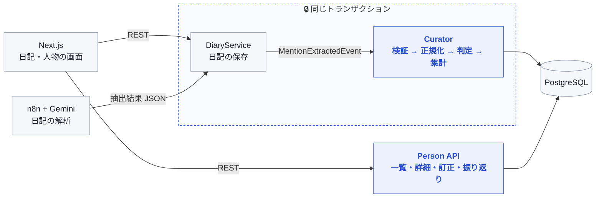
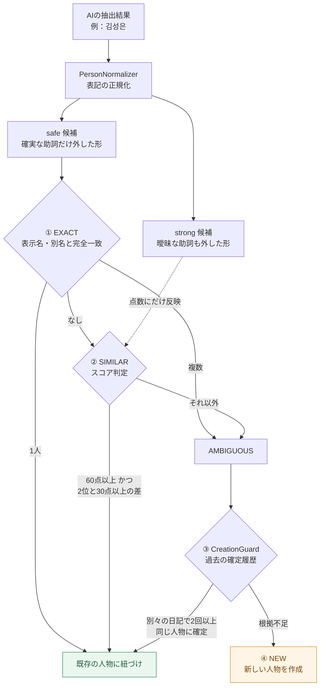

<div align="center">

# 📔 TADA ｜ AIダイアリー

### 日記の中の「人」を見つけ、思い出を人ごとに束ねる

**人物キュレーター（Curator）担当 ｜ 朱 韓榮（JU HAN YOUNG）**


[**▶ Demo**](https://tada-frontend-seven.vercel.app) ・ [**Frontend**](https://github.com/hanyx-00/tada-frontend) ・ [**Curator のコード**](./src/main/java/com/tada/tada/curator/) ・ [한국어](./README.ko.md)

</div>

---

## 🧭 このページについて

TADA は **5名のチームで開発した AI 絵日記サービス** です（2026.08 – 09）。<br>
日記を書くと AI が題名・キーワード・人物・場所・活動を抽出し、キーワードからステッカー画像を作ってカレンダーに残します。

このリポジトリはチームのバックエンドを私がフォークしたもので、本 README では **私が担当した「人物キュレーター」の設計と実装** を中心に説明します。

| | |
| --- | --- |
| 👥 **チーム** | 5名（バックエンドはドメインごとに分担） |
| 🙋 **担当** | 人物キュレーター — バックエンド API と画面の両方 |
| 📦 **規模** | `curator` パッケージ 約 9,600 行 ・ 単体テスト **128件** |
| 🧩 **主な技術** | Spring のイベント・トランザクション、JPA 悲観的ロック、PostgreSQL |

---

## ✨ 人物キュレーターでできること

| 機能 | 内容 |
| --- | --- |
| **人物の自動判定** | AI が抽出した人物名を、既存の人物と同一人物か判定して紐づける |
| **人物一覧・詳細** | 人ごとの登場回数、一緒に行った場所・活動、日記のタイムライン |
| **人物ごとの思い出** | その人が出てくる日記とステッカーをまとめて表示 |
| **訂正・名前変更** | 判定が間違っていたら、ユーザーが別の人物へ付け替え・名前を変更できる |
| **思い出の振り返り** | 「1年前の今日」「同じ曜日」「よく会う人」などの観点で過去の日記を1件提案 |

---

## 🏗 アーキテクチャと担当範囲



<sub>🟦 青い部分が私の担当です。日記の保存・AI 解析・認証などは他のメンバーが担当しました。</sub>

---

## 🔥 技術的な課題と解決

### ① 似た名前を誤ってまとめない「人物判定」

**課題** — 韓国語では名前の後ろに助詞がそのまま付きます。日本語の「田中**は**」「田中**さん**」のようなものですが、分かち書きがないため **助詞と名前の最後の文字が区別できない** ことがあります。

| 日記の表記 | 読み方 A | 読み方 B |
| --- | --- | --- |
| `김성은` | 人名「キム・ソンウン」 | 「キム・ソン」＋助詞「は」 |
| `가을이` | 人名「カウリ」 | 「カウル」＋呼びかけの「イ」 |
| `민수랑` | 「ミンス」＋助詞「と」 | — |

助詞を全部外すと別人が1人にまとまり、外さないと同じ人が何人にも分かれてしまいます。<br>
**一度まとめてしまった人物は、ユーザーが気づかないうちに日記のデータを混ぜてしまう** ため、「迷ったら自動でまとめない」方針で設計しました。

**解決** — 正規化と判定を分け、根拠の強さに応じて段階的に判断します。



- **2層の候補** — 曖昧な助詞（은/이/도/랑/씨/님/아）を外して初めて一致する形は、`EXACT` には使わず **類似度スコアの材料にだけ** 使います。
- **スコアは「点数」と「差」の両方で判定** — 姓の省略（김민혁 ↔ 민혁）や1文字違い（編集距離1）などを加点し、1位が60点以上でも **2位との差が30点未満なら自動で決めません**。
- **履歴による再利用** — 自動で決められなかった名前でも、**別々の日記で2回以上** 同じ人物に確定していれば再利用します。1つの長い日記で何度出てきても1回と数えます。
- **同じ日記の中で2つの名前が同じ人物にまとまらない** よう、すでに割り当てた人物は候補から外します。
- 判定の閾値は [`PersonMatchingPolicy`](./src/main/java/com/tada/tada/curator/policy/PersonMatchingPolicy.java) に定数としてまとめ、テストで境界値を確認しています。

📂 [`PersonNormalizer`](./src/main/java/com/tada/tada/curator/service/PersonNormalizer.java) ・ [`PersonMatchingService`](./src/main/java/com/tada/tada/curator/service/PersonMatchingService.java) ・ [`PersonCreationGuard`](./src/main/java/com/tada/tada/curator/service/PersonCreationGuard.java) ・ [`PersonResolverService`](./src/main/java/com/tada/tada/curator/service/PersonResolverService.java)

---

### ② 日記と人物データを「必ず一緒に」保存する

**課題** — 人物の処理だけが失敗すると、**人物情報のない日記** が残ってしまいます。逆に日記の保存が失敗したのに人物データだけ残るのも問題です。

**解決** — 日記の保存トランザクションの中で、イベントを **同期的に** 処理しています。

```java
// MentionExtractedEventListener
@EventListener   // AFTER_COMMIT にはしない
public void handle(MentionExtractedEvent event) {
    try {
        mentionExtractionProcessor.process(event);
    } catch (RuntimeException e) {
        log.error("...保存トランザクション全体を rollback する", e);
        throw e;   // 例外は握りつぶさない
    }
}
```

- `@TransactionalEventListener(AFTER_COMMIT)`、`REQUIRES_NEW`、例外の握りつぶしは **意図的に使わない** とコードにも明記しました。どれか1つでも使うと、日記だけがコミットされてしまうためです。
- 日記の完全削除時も同じ考え方で、子テーブル（Curator）→ 親（Diary）の順に同じトランザクションで削除します。
- 外部 AI（Gemini）の JSON は処理の最初に `ExtractionResultValidator` で検証し、欠損や不正な参照を原因の分かる例外として扱います。

---

### ③ 同時保存でも集計がずれない

**課題** — 同じ人物が登場する日記を同時に保存・修正すると、人物ごとの集計（登場回数など）を **古い値で上書き** したり、集計行の作成が主キーで衝突したりします。

**解決**

- `memory_person` の行を `PESSIMISTIC_WRITE` で **ロックしてから** 集計の元データを読みます。読む → ロックの順だと、古い値で計算してしまいます。
- 複数人をロックするときは **UUID の順に並べてから1件ずつ** ロックし、トランザクション同士のデッドロックを防ぎます。
- 人物の訂正（別名の INSERT）でも同じ順序でロックします。
- 再現検証：2つの条件 × 各50回、**100/100 回で集計が正しい** ことを確認しました。

📂 [`PersonAggregateService`](./src/main/java/com/tada/tada/curator/service/PersonAggregateService.java) ・ [`MemoryPersonRepository`](./src/main/java/com/tada/tada/curator/repository/MemoryPersonRepository.java)

---

### ④ AI の推定とユーザーの訂正を分けて持つ

**課題** — AI の判定は間違えることがあります。ユーザーが訂正しても、日記を修正するたびに AI の判定で上書きされては意味がありません。

**解決**

- 「AI が抽出した候補（`MentionCandidate`）」と「確定した人物（`MemoryPerson`）」を **別のテーブル** に分けました。
- 日記の本文を修正したときは、前回の候補と比べて **KEEP / ADD / REMOVE** だけを反映します。同じイベントが再処理されても結果は変わりません（冪等）。
- 訂正した名前は **別名（`PersonAlias`）** として保存し、次の日記からは自動で同じ人物に紐づきます。
- API は、他人のデータには **404**（存在自体を見せない）、画面が古いまま訂正しようとした場合には **409** を返します。

📂 [`MentionExtractionProcessor`](./src/main/java/com/tada/tada/curator/service/MentionExtractionProcessor.java) ・ [`PersonCorrectionService`](./src/main/java/com/tada/tada/curator/service/PersonCorrectionService.java)

---

### ⑤ 思い出の振り返り

ホーム画面に、過去の日記を1件だけ提案します。まず「どの観点で振り返るか」を決め、その中から日記を選びます。

| 観点 | 例 |
| --- | --- |
| 時間 | 12か月前 ・ 6か月前 ・ 3か月前の日記 |
| 人・場所・活動 | よく登場する人物、よく行く場所、繰り返している活動 |
| その他 | 同じ曜日、最初の日記、どれにも当てはまらないときの代替 |

- 候補がある観点の中からランダムに選ぶので、毎回同じ種類の提案に偏りません。
- 「この前の○曜日」のような文言と矛盾しないよう、今日と未来の日付の日記は除外します。
- 「別の思い出」ボタンでは今表示中の日記を除外しますが、日記が1件しかない場合は同じものを再表示します。
- 複数の観点で同じ日記一覧を使うため、DB 照会は1回にまとめています。

📂 [`MemoryRecallService`](./src/main/java/com/tada/tada/curator/service/MemoryRecallService.java)

---

## 🔌 担当 API

| Method | Endpoint | 内容 |
| --- | --- | --- |
| `GET` | `/api/curator/persons` | 人物一覧 |
| `GET` | `/api/curator/persons/{id}` | 人物詳細（一緒の場所・活動の統計） |
| `GET` | `/api/curator/persons/{personId}/timeline` | 人物が登場する日記のタイムライン（ページング・並び替え） |
| `GET` | `/api/curator/persons/{personId}/memories` | 人物ごとの思い出（日記・ステッカー） |
| `PATCH` | `/api/curator/persons/{personId}/candidates/{candidateId}` | 判定の訂正（既存の人物 / 新しい名前へ） |
| `PATCH` | `/api/curator/persons/{personId}` | 人物の名前変更 |
| `GET` | `/api/curator/memory-recalls` | 思い出の振り返り |

<sub>Swagger UI：サーバー起動後 `http://localhost:8080/swagger-ui/index.html`</sub>

---

## 🧪 テスト

`curator` パッケージの単体テストは **128件** です（JUnit 5 ・ Mockito ・ AssertJ）。

| 対象 | 件数 | 主な確認内容 |
| --- | ---: | --- |
| 人物判定（正規化・マッチング・作成ガード・解決） | **74** | 助詞の曖昧さ、姓の省略、閾値の境界、履歴の数え方 |
| 抽出結果の検証・フィルタ | 11 | AI の JSON の欠損・重複・不正な参照 |
| 候補の反映（KEEP / ADD / REMOVE） | 15 | 新規・再処理・本文修正 |
| 状態変更・削除・イベント | 14 | ゴミ箱移動・復元・完全削除時の整合性、例外の再送出 |
| 照会・訂正・別名・振り返り | 14 | 権限、競合（409）、別名の重複防止、振り返りの候補選び |

```bash
./gradlew test          # 外部サービスを呼ぶ手動テストは除外
```

---

## 🛠 技術スタック（プロジェクト全体）

| 区分 | 技術 |
| --- | --- |
| Backend | Java 17, Spring Boot 3.5, Spring Data JPA, Spring Security, OAuth2 Client, JWT |
| Database | PostgreSQL（Supabase）, pgvector |
| AI / 自動化 | n8n Webhook, Gemini, Voyage Embedding |
| Storage | Supabase Storage |
| Frontend | Next.js 16, React 19, TypeScript, TanStack Query, Tailwind CSS 4 |
| Deploy | Railway（Backend）, Vercel（Frontend） |

---

## 📁 パッケージ構成

```text
src/main/java/com/tada/tada/
├── global/     # 設定・セキュリティ・共通レスポンス・イベント
├── auth/       # ソーシャルログイン・トークン
├── diary/      # 日記
├── calendar/   # カレンダー
├── search/     # 意味検索
└── curator/    # 👈 人物キュレーター（担当）
    ├── controller/   # Person API・振り返り API
    ├── event/        # 日記保存・状態変更イベントの受信
    ├── validation/   # AI 抽出結果の検証
    ├── service/      # 正規化・判定・集計・訂正
    ├── policy/       # 判定の閾値
    ├── entity/       # 人物・候補・別名・集計
    └── repository/   # 悲観的ロックを含む照会
```

---

## 👥 チーム

| ドメイン | 担当 |
| --- | --- |
| global（共通） | 상훈 |
| auth（ソーシャルログイン） | 진경 |
| diary / calendar | 민혁 |
| search | 형호 |
| **curator（人物キュレーター）** | **한영（私）** |

<sub>環境変数・ローカル実行・ブランチ戦略などチーム共通の情報は [한국어 README](./README.ko.md) にまとめています。</sub>

---

<div align="center">

**朱 韓榮（JU HAN YOUNG）** ・ バックエンドエンジニア志望<br>
📫 a98220919@gmail.com ・ 🐙 [github.com/hanyx-00](https://github.com/hanyx-00)

</div>
